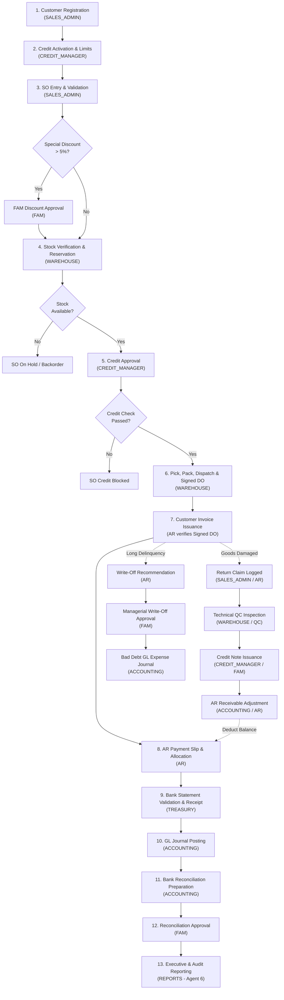

# Scope Amendment — UltraOps Revenue Workflow & Ownership Update

**Author:** Agent 6 (Shared Contract Coordinator & Reports Owner)  
**Date:** 29 October 2026  
**Status:** Canonical Project Amendment (Phase A Bootstrap)

---

## 1. Executive Summary & Ownership Realignment

This amendment formally records the user's updated ownership overrides to the initial ownership matrix in `PROJECT_CONTRACT.md` and establishes the shared contracts, security boundaries, and technical architecture for the integrated commercial revenue workflow.

### 1.1 Updated Module Ownership

| Agent | Module Scope | Owned Paths | Core Responsibilities |
| --- | --- | --- | --- |
| **Agent 2** | **Dashboard only** | `src/features/dashboard/**`, `src/app/(workspace)/dashboard/**`, own tests/docs | Authorized operational KPIs, period trends, queue summaries. Does not own Reports. |
| **Agent 3** | **Procurement only** | `src/features/procurement/**`, `src/app/(workspace)/procurement/**`, `src/server/db/migrations/procurement/**`, own tests/docs | Suppliers, material requests, RFQs, vendor evaluations, purchase orders, purchasing approval workflows. |
| **Agent 4** | **Inventory only** | `src/features/inventory/**`, `src/app/(workspace)/inventory/**`, `src/server/db/migrations/inventory/**`, own tests/docs | Raw materials, stock balances, goods receipts, QC inspections, **plus additive dispatches (`/inventory/dispatches`) and customer returns (`/inventory/returns`)**. |
| **Agent 5** | **Finance only** | `src/features/finance/**`, `src/app/(workspace)/finance/**`, `src/server/db/migrations/finance/**`, own tests/docs | Supplier invoices, three-way matching, AP payables, outgoing payments, general ledger journals, **plus additive revenue operations (`/finance/revenue`) and bank reconciliation subview (`/finance/journals?subview=reconciliation`)**. |
| **Agent 6** | **Reports & Shared Integration** | `src/features/reports/**`, `src/app/(workspace)/reports/**`, `src/server/db/migrations/reports/**`, shared contracts, integration tests/docs | Multi-workflow audit trail, cross-module traceability, operational/financial report querying, CSV export, shared contracts, deterministic migration ordering, and integration seeding. |

### 1.2 Primary Menu & Sidebar Invariants

- The primary navigation remains strictly **five items**:
  1. `Dashboard` (`/dashboard`)
  2. `Procurement` (`/procurement/*`)
  3. `Inventory` (`/inventory/*`)
  4. `Finance` (`/finance/*`)
  5. `Reports` (`/reports/*`)
- Bottom navigation retains separate **Settings** (`/settings`), accessible exclusively to `ADMIN`.
- **No primary "Sales" menu:** In compliance with explicit enterprise constraints, all commercial revenue operations are organized cleanly within existing domains:
  - Commercial transactions, customer accounts, credit, billing, and receipts reside under **Finance** (`/finance/revenue`).
  - Physical picking, shipping, delivery orders, and return receiving reside under **Inventory** (`/inventory/dispatches`, `/inventory/returns`).
  - Executive revenue aggregates reside in **Dashboard** (`/dashboard`).
  - Cross-cutting audit, receivable aging, sales summaries, and document traceability reside in **Reports** (`/reports`).

---

## 2. Revenue Roles & Least-Privilege Permission Architecture

Accounts maintain strictly **one role per user**, consistent with core security guarantees. Admin users remain completely separated from business operations and cannot approve commercial transactions.

### 2.1 Role Definitions

1. `SALES_ADMIN`: Front-office commercial administration. Registers customers, inputs sales orders, requests discounts.
2. `CREDIT_MANAGER`: Risk management. Evaluates counterparty creditworthiness, activates credit lines, sets credit limits/payment terms, approves sales orders exceeding risk thresholds, approves credit notes.
3. `AR` (Accounts Receivable Specialist): Customer billing and collections. Verifies signed delivery evidence, issues customer tax invoices, records customer payment slips, matches payments, recommends bad debt write-offs.
4. `FAM` (Finance & Accounting Manager): Senior financial governance. Approves high-tier discounts (> 5%), authorizes bad debt write-offs, reviews and approves bank reconciliations, and exercises financial oversight.
5. Reused roles with revenue duties:
   - `WAREHOUSE`: Physical stock verification for sales orders, stock reservations, pick/pack/dispatch, signed delivery order (DO) evidence capture, and customer return restock receiving.
   - `TREASURY`: Incoming bank payment validation (verifying bank statements against AR slips), cash receipt confirmation.
   - `ACCOUNTING`: General ledger journal entry review and posting, bank reconciliation preparation, GL balance tracking.
   - `AUDITOR`: Read-only access to all business read models across procurement, inventory, revenue, finance, and system audit logs.

### 2.2 Granular Permissions Matrix

To prevent page access alone from granting unlimited authority, revenue capabilities are segmented by granular permissions:

```
revenue:read                 - View /finance/revenue dashboard and subviews
dispatches:read              - View /inventory/dispatches queue
dispatches:write             - Pick, pack, dispatch SOs, record signed DO evidence
returns:read                 - View customer return claims
returns:write                - Record return claim submission
returns:inspect              - Technical QC inspection of returned goods
customers:read               - View customer master records and credit profile
customers:write              - Register/modify customer master data
credit:manage                - Activate customer credit, set/adjust credit limits
sales_orders:read            - View sales orders and status
sales_orders:write           - Create, edit, submit sales orders
sales_orders:approve         - Approve sales order credit release / discount approval
customer_invoices:read       - View customer billing invoices
customer_invoices:write      - Generate customer invoices upon signed DO verification
receivables:read             - View AR aging schedules and receivable balances
receipts_incoming:read       - View incoming customer payment records
receipts_incoming:write      - Record customer payment slips and invoice allocations
receipts_incoming:validate   - Treasury bank statement validation of cash receipts
credit_notes:write           - Issue credit notes for returns / price adjustments
writeoffs:read               - View bad-debt write-off history and queue
writeoffs:recommend          - AR bad-debt write-off recommendation
writeoffs:approve            - FAM bad-debt write-off authorization
reconciliation:read          - View bank reconciliations under journals
reconciliation:write         - Accounting preparation and transaction matching
reconciliation:approve       - FAM formal bank reconciliation authorization
```

---

## 3. Registered Destinations & Subviews

### 3.1 New Route Registrations

All destinations are registered in `src/shared/routes.ts` with explicit permissions:

1. `/inventory/dispatches` — Permission: `dispatches:read` (Owner: Agent 4)
2. `/inventory/returns` — Permission: `returns:read` (Owner: Agent 4)
3. `/finance/revenue` — Permission: `revenue:read` (Owner: Agent 5)

### 3.2 Finance Revenue Subviews (`/finance/revenue?subview=<id>`)

Page access alone does not grant all revenue authority. The subviews enforce granular authorization:

| Subview ID | Subview Label | Read Permission | Action / Write Authority | Description |
| --- | --- | --- | --- | --- |
| `customers` | Customers & Credit | `customers:read` | `customers:write` / `credit:manage` | Customer registration, tax IDs, credit limits, payment terms. |
| `sales-orders` | Sales Orders | `sales_orders:read` | `sales_orders:write` | Order entry, price checks, line item creation. |
| `credit-decisions` | Credit Decisions | `sales_orders:read` | `sales_orders:approve` | Credit limit checks, credit approval, credit release holds. |
| `invoices` | Customer Invoices | `customer_invoices:read` | `customer_invoices:write` | Tax invoice generation; requires verified signed DO evidence. |
| `receipts` | Incoming Receipts | `receipts_incoming:read` | `receipts_incoming:write` / `validate` | AR payment slip recording, allocation, Treasury validation. |
| `returns` | Returns & Credit Notes | `returns:read` | `credit_notes:write` | Return claim tracking and authorized credit note issuance. |
| `write-offs` | Bad Debt Write-Offs | `writeoffs:read` | `writeoffs:recommend` / `approve` | Delinquent receivable write-off recommendations & approvals. |

### 3.3 Bank Reconciliation Subview (`/finance/journals?subview=reconciliation`)

Integrated seamlessly into the existing `/finance/journals` route:
- Preparation authority: `ACCOUNTING` (`reconciliation:write`)
- Formal approval authority: `FAM` (`reconciliation:approve`)

---

## 4. Canonical Revenue Workflow Sequence



### Detailed Sequence Stages:

1. **Customer Registration:** `SALES_ADMIN` registers counterparty details (legal name, address, tax NPWP, contact).
2. **Credit Activation:** `CREDIT_MANAGER` assesses risk, activates account (`ACTIVE`), sets credit limit in IDR minor units, and defines payment term days (e.g. 30 days).
3. **Sales Order Validation:** `SALES_ADMIN` records line items, unit prices, and requested discounts. If discounts exceed 5%, `FAM` approval is required.
4. **Physical Stock Verification & Reservation:** `WAREHOUSE` verifies available stock across designated warehouses. Available stock must exclude held, rejected, and already-reserved inventory. Creates a `StockReservation`.
5. **Credit Approval:** `CREDIT_MANAGER` evaluates customer's utilized credit + pending order value against credit limit:
   $$\text{Credit Exposure} = \text{Outstanding AR Invoices} + \text{Unbilled Released Sales Orders} - \text{Unallocated Receipts}$$
   Obligations transition without double-counting. Orders exceeding available credit are held until payment or credit manager release.
6. **Dispatch & Signed Delivery Order:** `WAREHOUSE` generates Delivery Order (`DO`), picks items, and dispatches shipment. Upon delivery, the recipient signs the physical slip. Warehouse records signed evidence (recipient name, timestamp, signed slip reference).
7. **Customer Billing / Invoice:** `AR` issues `CustomerInvoice`. Invariant: Customer invoices cannot be issued without verified signed delivery order evidence.
8. **Incoming Payment Evidence & Allocation:** Customer submits payment slip. `AR` logs `IncomingReceipt` and allocates amounts to outstanding customer invoices.
9. **Treasury Validation:** `TREASURY` matches payment slips against bank account statement lines, verifying settlement, and confirms cash receipt.
10. **Accounting Posting:** `ACCOUNTING` reviews and posts GL journal entries (Debit Cash/Bank, Credit Accounts Receivable).
11. **Bank Reconciliation:** `ACCOUNTING` matches book bank entries against external bank statements. `FAM` reviews and signs off on the completed reconciliation.
12. **Audit & Reporting:** Read models feed Dashboard queues and Reports audit trails.

---

## 5. Cross-Module Service Interfaces

Dedicated contracts live in `@/shared/contracts/revenue` and service interfaces in `@/shared/services/revenue-interfaces`:

- `FinanceToInventoryService`: Stock verification, active reservations, dispatch eligibility checks, return QC inspections. Implemented by Agent 4, consumed by Agent 5.
- `InventoryToFinanceService`: Approved SO lookups, customer credit profile validation, delivery progress tracking, signed DO evidence verification, return technical findings. Implemented by Agent 5, consumed by Agent 4.
- `DashboardRevenueReadModel`: Aggregates for pending credit approvals, dispatches, overdue receivables, and revenue KPIs. Consumed by Agent 2.
- `ReportsRevenueReadModel`: AR aging summaries, sales revenue summaries, incoming receipt reports, credit note/write-off adjustments, bank reconciliations, and end-to-end document traceability. Consumed by Agent 6.

---

## 6. Canonical Fixture Specifications

Stable identifiers in `src/shared/fixtures/index.ts`:

- **Customers:**
  - `cust_indofood` ("PT Indofood Sukses Makmur", Limit: Rp500,000,000, Terms: 30 days)
  - `cust_mayora` ("PT Mayora Indah Tbk", Limit: Rp300,000,000, Terms: 30 days)
- **Accounts:**
  - `acc_1101_cash_bca` (1101 Bank BCA - Operating, ASSET)
  - `acc_1103_ar` (1103 Trade Accounts Receivable, ASSET)
  - `acc_1104_allowance` (1104 Allowance for Doubtful Accounts, ASSET)
  - `acc_2101_ap` (2101 Trade Accounts Payable, LIABILITY)
  - `acc_4101_sales` (4101 Commercial Sales Revenue, REVENUE)
  - `acc_4102_returns` (4102 Sales Returns & Allowances, REVENUE)
  - `acc_6105_bad_debt` (6105 Bad Debt Expense, EXPENSE)
- **Revenue Documents:**
  - `so_261029_0001` (`SO-261029-0001`, Milk Powder 5,000 kg @ Rp25,000 = Rp125M)
  - `res_261029_0001` (Stock reservation for 5,000 kg)
  - `do_261029_0001` (`DO-261029-0001`, Dispatched 5,000 kg, Signed by Budi Santoso)
  - `cinv_261029_0001` (`CINV-261029-0001`, Total Rp125M)
  - `rcpt_261029_0001` (`RCPT-261029-0001`, Received Rp100M, Outstanding Rp25M)
  - `ret_261029_0001` (`RET-261029-0001`, Claimed 200 kg)
  - `cn_261029_0001` (`CN-261029-0001`, Credited Rp5M, Outstanding Rp20M)
  - `wroff_261029_0001` (`WROFF-261029-0001`)
  - `brec_261029_0001` (`BREC-261029-0001`, BCA Operating Account)
- **Revenue Users:**
  - `usr_sales_admin` (`sales_admin@ultraops.local`, `SALES_ADMIN`)
  - `usr_credit_manager` (`credit_manager@ultraops.local`, `CREDIT_MANAGER`)
  - `usr_ar` (`ar@ultraops.local`, `AR`)
  - `usr_fam` (`fam@ultraops.local`, `FAM`)

---

## 7. Migration & Seeding Strategy

- **Separate Namespaces:** Core migrations remain in `migrations/core/`. Module migrations belong strictly in `migrations/inventory/`, `migrations/procurement/`, `migrations/finance/`, `migrations/reports/`.
- **Append-only Migrations:** Applied migrations (`001_auth.sql`, `002_document_numbers.sql`) are immutable. Core migration `003_revenue_roles.sql` was added additively to expand the role CHECK constraint.
- **Cross-module Dependencies:** No cross-module foreign key constraints should be introduced across separate namespace migrations. Integration foreign keys or multi-table consistency belong in `zz_integration/` or Agent 6 integration.
- **Module-owned Seeds:** Business seeds remain owned by their module author (e.g. `src/features/inventory/seed.ts`, `src/features/finance/seed.ts`). Agent 6 coordinates the unified development seed command during final integration.
